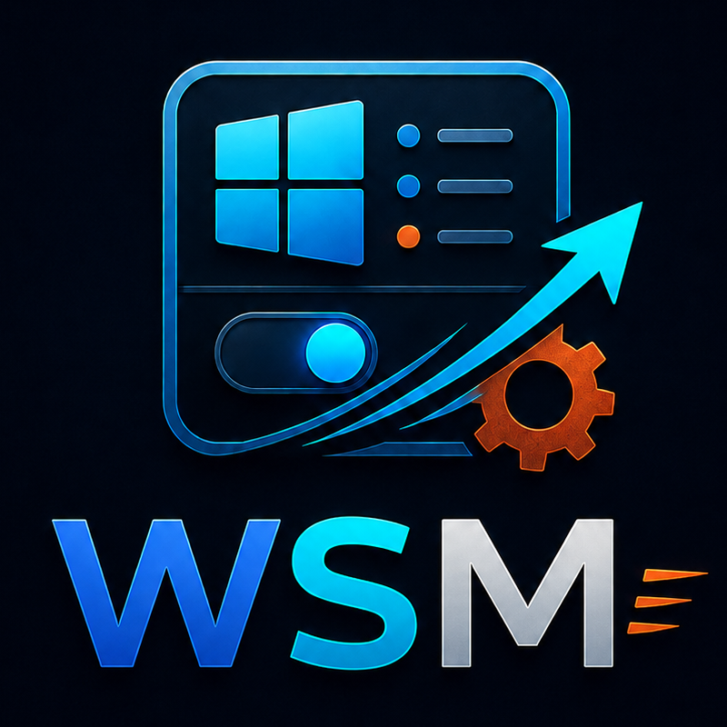

# Win Startup Manager

<p align="center">
  
</p>

[](https://github.com/CodyKoInABox/winstartupmanager/actions/workflows/ci.yml)
[](LICENSE)
[](https://www.rust-lang.org/)
[](https://www.microsoft.com/windows)

A fast, native Windows startup manager written in Rust. It looks beyond the small list shown in Task Manager so you can see which apps, tasks, and background services actually launch with your PC—and safely prevent the ones you do not want.

## Why this exists

Windows has no single API or screen that covers every startup mechanism. An app can start from a registry value, a shortcut, a scheduled task, or an automatic service. Win Startup Manager brings the common mechanisms into one searchable interface while preserving the source of every entry.

### What it finds

| Source | Coverage | Safe control |
| --- | --- | --- |
| Registry | Current-user and all-user `Run` / `RunOnce`, both 32-bit and 64-bit views; policy entries are visible | Current-user values are reversible; machine-wide and policy values are read-only in v0.1 |
| Startup folders | Current-user and common Startup known folders, including resolved `.lnk` targets | Current-user files are reversibly parked; the common folder is read-only in v0.1 |
| Scheduled tasks | Hidden and visible tasks in all folders with boot or sign-in triggers | Uses Task Scheduler's supported task enabled flag |
| Services | Automatic and delayed-automatic Win32 services | Changes third-party services to Manual; never stops or deletes them |

Windows components, launch-protected services, per-user service instances, machine-wide registry/folder entries, policy entries, and scheduled tasks with unrelated extra triggers are read-only by default.

## Safety first

- Every mutable entry has a stable source identity and a revision fingerprint. If it changed after the scan, the app refuses a stale write.
- Current-user Registry and Startup-folder changes are written to an atomic recovery journal *before* Windows state is changed.
- Journal updates hold an OS-level interprocess lock, so two open app instances cannot overwrite each other's recovery records.
- Restore operations never overwrite a new value or file that appeared in the original location.
- Parked Startup files are fully content-hashed and path-checked before restoration.
- Services are transactionally changed from Automatic to Manual and verified on both sides. They keep running in the current session and can still be started by their app.
- The app does not write Explorer's undocumented `StartupApproved` binary values.
- The main app starts unelevated. It offers a clear UAC restart only for supported task and service changes.
- Scans are read-only, run in background workers, and report partial-access warnings instead of hiding all results.

See [Recovery](docs/recovery.md) and [Security](SECURITY.md) for the complete model.

## Download and run

Download the portable Windows ZIP and its `.sha256` file from [GitHub Releases](https://github.com/CodyKoInABox/winstartupmanager/releases). Verify the archive before extracting it:

```powershell
$release = "win-startup-manager-v0.1.0-windows-x86_64"
$expected = (Get-Content "$release.zip.sha256").Split()[0]
$actual = (Get-FileHash "$release.zip" -Algorithm SHA256).Hash.ToLowerInvariant()
if ($actual -ne $expected) { throw "Win Startup Manager checksum mismatch" }
Expand-Archive "$release.zip"
```

Open the extracted folder and run **Win Startup Manager.exe**. Published CI builds are not code-signed yet, so Windows SmartScreen may identify the publisher as unknown. Only continue after confirming the download came from this repository and its SHA-256 checksum matches; production signing is tracked as release work.

Run it normally first. Use **Run as administrator** inside the app only when you want to change an entry marked as requiring it.

## Build from source

Requirements:

- Windows 10 or Windows 11, x86-64
- Rust 1.97.1 or newer (the repository toolchain is pinned in [`rust-toolchain.toml`](rust-toolchain.toml))
- Visual Studio Build Tools with **Desktop development with C++**
- A Windows 10/11 SDK

```powershell
git clone https://github.com/CodyKoInABox/winstartupmanager.git
cd winstartupmanager
cargo run --release
```

For a read-only provider check without opening the GUI:

```powershell
cargo run --example scan
```

## Development

```powershell
cargo fmt --all -- --check
cargo clippy --all-targets -- -D warnings
cargo test --all-targets
cargo build --release --locked
```

The app is pure Rust:

- [`eframe` / `egui`](https://github.com/emilk/egui) for the native, GPU-rendered, accessible UI
- Microsoft's [`windows`](https://github.com/microsoft/windows-rs) bindings for Task Scheduler, services, known folders, Shell links, and UAC
- `winreg` for lossless registry values and alternate registry views

Provider scans run concurrently and stream source results back to the event-driven UI. The app has no resident background process and does no work while closed. See [Architecture](docs/architecture.md).

## Data and privacy

Everything stays on the local PC. Win Startup Manager has no analytics, account system, telemetry, or network feature. It never executes a command it discovers.

Recovery state and logs are stored below:

```text
%LOCALAPPDATA%\WinStartupManager\Win Startup Manager\data\
```

Removing the application does not automatically delete parked startup files or the recovery journal.

## Current limitations

- Packaged app `StartupTask` control is not included. Microsoft's public API only returns startup tasks for the *current package*, not other installed apps. The app links to Windows Startup settings for those entries.
- Task-level disable affects every trigger on a scheduled task. Tasks that mix boot/sign-in triggers with unrelated triggers are therefore locked.
- All-user Registry and common Startup-folder entries are discovery-only in v0.1. A user-writable recovery journal is deliberately never treated as authority for an elevated registry or filesystem restore.
- Driver, Winlogon, LSA, shell-extension, WMI, and other security-sensitive Autoruns locations are intentionally outside the mutable v1 scope.
- Publisher signatures and app icons are not yet enriched from executable metadata.
- The first release target is `x86_64-pc-windows-msvc`; ARM64 is on the roadmap.

The Windows behavior behind these choices is documented by Microsoft: [Run/RunOnce](https://learn.microsoft.com/windows/win32/setupapi/run-and-runonce-registry-keys), [alternate registry views](https://learn.microsoft.com/windows/win32/winprog64/accessing-an-alternate-registry-view), [known Startup folders](https://learn.microsoft.com/windows/win32/shell/knownfolderid), [Task Scheduler enumeration](https://learn.microsoft.com/windows/win32/api/taskschd/nf-taskschd-itaskfolder-gettasks), [service configuration](https://learn.microsoft.com/windows/win32/api/winsvc/nf-winsvc-changeserviceconfigw), and [package-scoped StartupTask](https://learn.microsoft.com/uwp/api/windows.applicationmodel.startuptask.getforcurrentpackageasync).

## Contributing

Issues and pull requests are welcome. Please read [CONTRIBUTING.md](CONTRIBUTING.md) before changing a Windows provider or mutation path. Security-sensitive reports should follow [SECURITY.md](SECURITY.md).

Licensed under the [MIT License](LICENSE).
