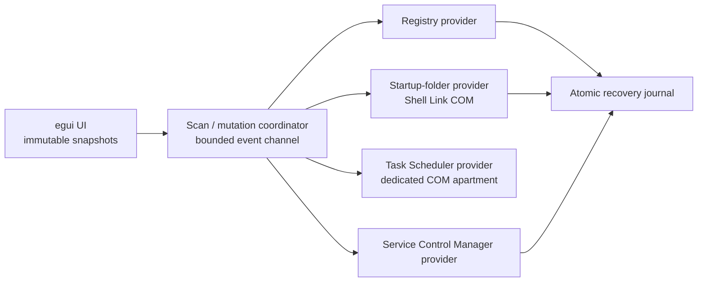

# Architecture

Win Startup Manager is one Rust crate with three deliberately separated layers.

## Domain

`StartupEntry` is the normalized, serializable snapshot presented to the UI. It contains:

- stable ID derived only from source provenance;
- raw command and resolved executable where available;
- source, scope, trigger, current state, risk, and permission requirement;
- structured provider locator;
- fingerprint of the provider's mutable preimage.

Entries are not merged just because they resolve to the same executable. An app may own a registry value, scheduled task, and service; each persistence mechanism must remain visible and independently auditable.

## Workers

`scan::spawn_scan` creates one coordinator and one worker per provider. Provider results are sent through a bounded `SyncSender`; each event requests an `egui` repaint. The UI ignores stale scan generations and replaces one source at a time, so partial results appear without blocking interaction.

COM objects never cross threads. Startup-folder Shell Link work and Task Scheduler work initialize and release their own multithreaded COM apartments.

## Mutations

The controller accepts a complete scanned entry and a desired state. Each provider then:

1. validates that the locator belongs to that provider;
2. re-reads the current source;
3. compares the current fingerprint with the scanned fingerprint;
4. writes recovery intent before any destructive change;
5. applies one narrow documented operation;
6. leaves the recovery record until restoration succeeds.

All journal-backed mutations hold one OS-level lock across state reload, Windows mutation, and receipt update, so concurrent app instances cannot lose each other's recovery records. Receipt IDs and source provenance are recomputed rather than trusted. Registry and file restores refuse occupied destinations, and only current-user Registry/Startup-folder locations are mutable in v0.1; user-writable journal data can never authorize an elevated HKLM or common-Startup write. Parked files are path- and fully content-verified before restore. Task definitions are not rewritten. Service changes use the SCM, preserve the exact original start mode and delayed-auto flag, verify both sides of the change, and attempt automatic rollback if a multi-step transition fails.

## Platform boundary

All Win32 calls and unsafe buffer handling live in `src/platform/windows/`. Aligned `usize` buffers are used for variable-sized SCM structures. Windows-owned strings are copied before their backing buffer or COM interface is released.

## Persistence

`StateStore` is small versioned JSON written with `atomic-write-file`. A separate stable lock file provides crash-released interprocess exclusion while the JSON itself can still be atomically replaced. It is intentionally not SQLite: writes are rare, recovery data is small, and a human-inspectable format is valuable during repair.
